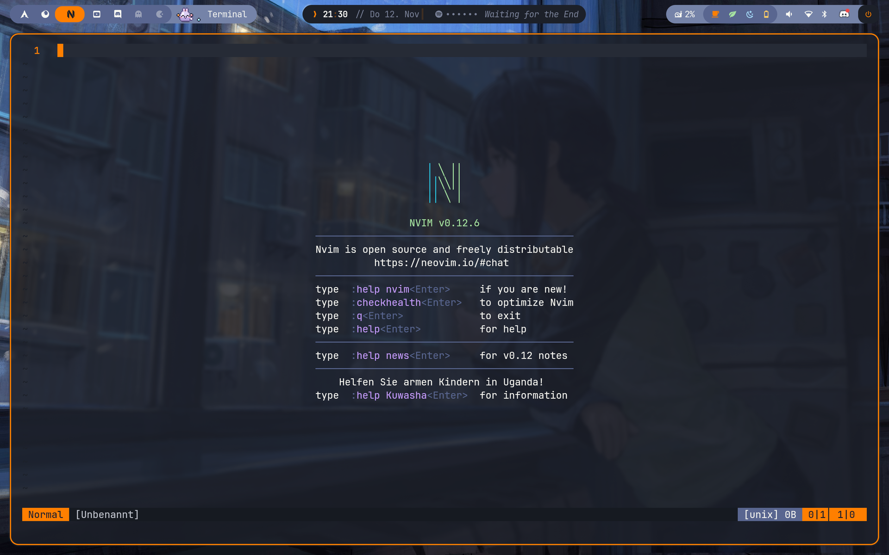
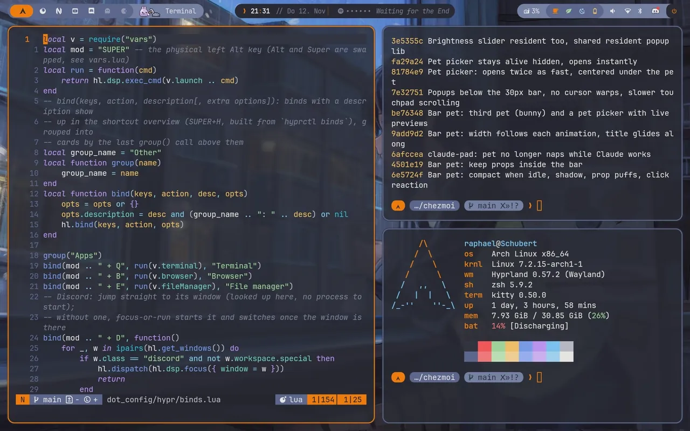
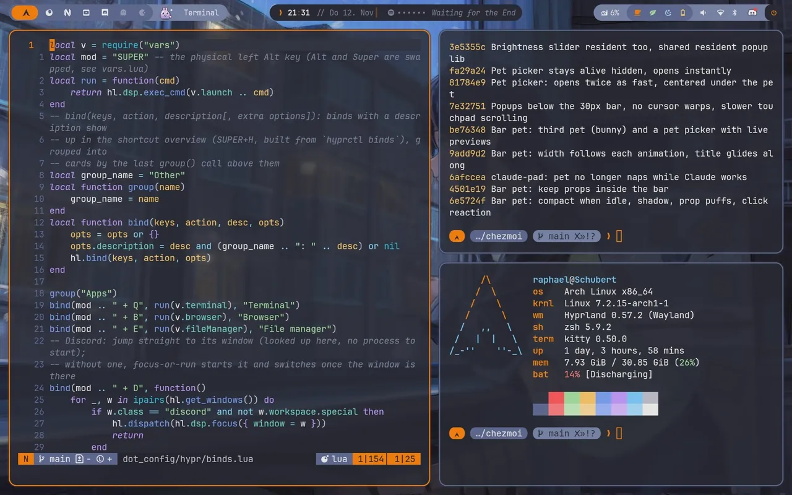
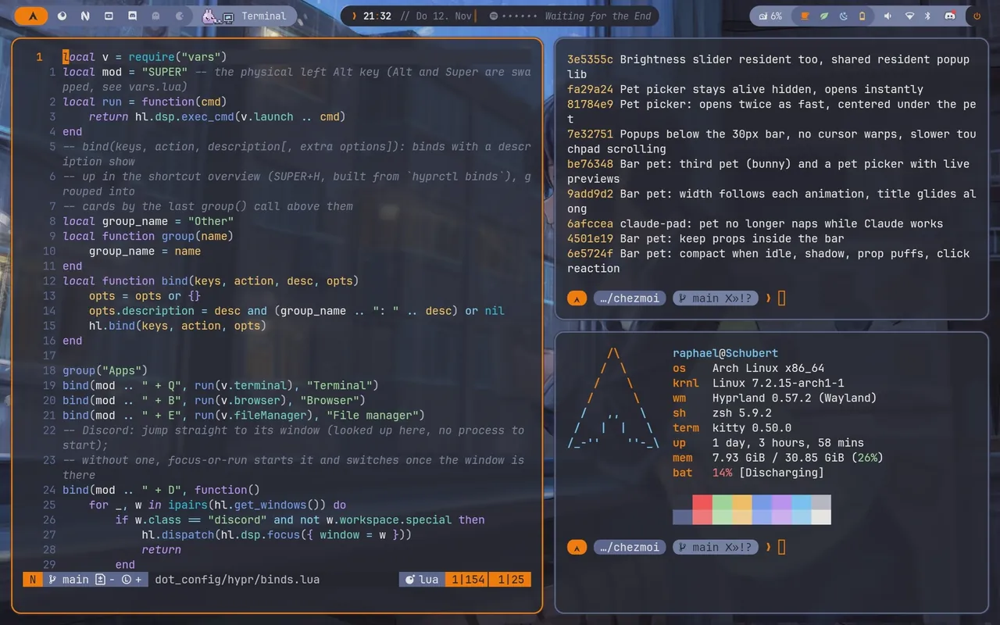
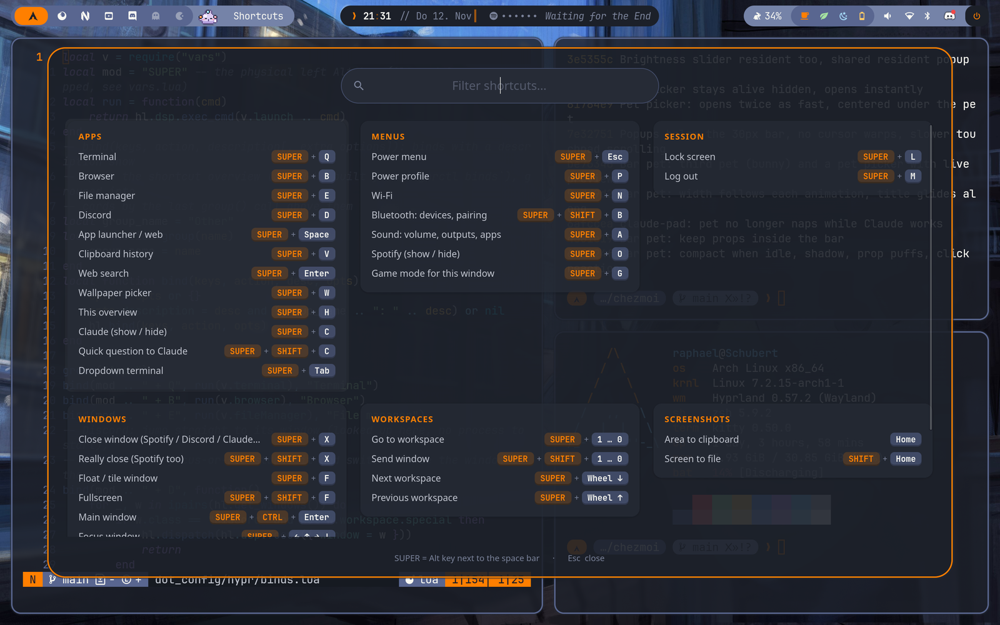

<div align="center">

# slate

**A calm, playful Hyprland desktop for Arch Linux.**<br>
Slate-blue glass, one orange accent, and a little pixel pet living in your bar.

[](https://archlinux.org)
[](https://hyprland.org)
[](https://www.chezmoi.io)
[](packages/)



[Features](#whats-inside) · [Install](#install) · [Shortcuts](#shortcuts) · [Make it yours](#make-it-yours) · [Docs](#docs)

</div>

---

Most riced desktops look great in a screenshot and fall apart on day two.
**slate** is built the other way around: it is the desktop I use every day, for
code, games and everything in between, and it is tuned until nothing gets in the way.

It is opinionated. Every color, gap and font comes from **one design system**, so
the bar, the launcher, the terminal, Neovim, the lock screen and even the boot menu
look like they were made by the same hand. It is playful where it does not cost
you anything: window titles type themselves, the CPU icon turns from snail into
rocket, and a small pixel pet keeps you company while Claude Code thinks.

And it is honest Arch: **official repos only**, plain package lists, one script,
no curl-to-bash. You can read every line of it in an afternoon.

## What's inside

<table>
<tr>
<td width="50%" valign="top">

### A bar that feels alive

A `cava` music visualizer, window titles with a typewriter effect, a blinking
terminal clock, icons with moods (brightness follows the sun) and a pixel pet
that reacts to your Claude Code session.

</td>
<td width="50%" valign="top">

### Spotlight, but on Linux

`SUPER+Space` opens an icon grid of your apps. Typed something that is not an
app? Hit Enter and it becomes a web search.

</td>
</tr>
<tr>
<td></td>
<td></td>
</tr>
<tr>
<td valign="top">

### Wallpapers, with a preview

`SUPER+W` shows a grid of `~/Pictures/Wallpapers`. Enter sets the desktop,
Shift+Enter the login screen, or let it shuffle every 30 minutes. Every login
greets you with a fresh pair.

</td>
<td valign="top">

### Menus that are just *there*

Sound with per-app volume, Bluetooth pairing, Wi-Fi with the password typed
right in the list, battery + power profile, a playful centered session menu.
Small GTK4 popups that follow the system live and wait in the background, so
they open with no delay at all.

</td>
</tr>
<tr>
<td></td>
<td></td>
</tr>
<tr>
<td valign="top">

### A terminal from above

`SUPER+Tab` drops a kitty terminal over whatever you are doing, and slides it
away again.

</td>
<td valign="top">

### Never forget a shortcut

`SUPER+H` shows every keybinding, built live from `binds.lua`. If it's bound,
it's listed. It can't go stale.

</td>
</tr>
<tr>
<td></td>
<td></td>
</tr>
</table>

### And the parts you don't see

| | |
|---|---|
| 🎮 **Gaming** | `game-watch` spots games by *how* they run (Steam, Proton/Wine, Modrinth, gamescope, ...) and switches on GameMode and the performance profile. No per-game setup. |
| 🔋 **Power** | Performance on AC, power-saver on battery, switched by udev. The battery icon fills with bolts while charging. |
| ✏️ **Neovim** | Built from scratch on `vim.pack` + `mini.nvim`, native LSP, `conform` formatting, same palette. |
| 🔐 **Login & boot** | A custom SDDM theme and an optional GRUB theme, both generated from the palette. hyprlock greets you with a typewriter line. |
| 🛟 **Snapshots** | snapper + snap-pac take a snapshot of `/` before and after every pacman run. Broke something? Roll back. |
| ⚡ **Fast** | Popups stay resident, the animated bar was profiled down to a few % CPU. |
| 🐾 **Claude Code** | Optional: `SUPER+C` toggles a long-running Claude session, and the bar pet shows whether it is thinking, waiting or done. |

## Install

On any existing Arch install (any bootloader, any filesystem):

```sh
sudo pacman -S --needed git
git clone https://github.com/Fubge/dotfiles ~/.local/share/chezmoi
~/.local/share/chezmoi/bootstrap.sh     # add --dry-run to just look
reboot
```

That's it. Before it touches anything, it asks about your machine:

```text
CPU vendor (microcode package)                     intel / amd      (detected)
Graphics (driver packages)                         intel / amd / nvidia / none
Keyboard layout (xkb, e.g. us, de, fr)             us
Locale for dates in the bar                        en_US.UTF-8
Internal display mode / scale                      preferred / auto
Install the gaming stack / personal apps           yes / yes
Manage the boot chain (GRUB, cmdline, console)?    no   <- leave this off unless
                                                           you follow docs/install.md
```

Then it enables multilib, installs the package lists, applies the dotfiles, sets
up the login screen and starts the services. Run it again whenever you like; it
only changes what is missing. Starting from a blank disk? **[docs/install.md](docs/install.md)**
walks through a full LUKS + btrfs + UKI setup.

> [!NOTE]
> Daily driver on a ThinkPad X9-15p (Intel Arc, 2880x1800 OLED).
> AMD graphics should work out of the box; NVIDIA is wired up but untested.

## Shortcuts

`SUPER+H` shows all of them. The ones you'll use in the first hour:

| Keys | Action | Keys | Action |
|---|---|---|---|
| `SUPER+Space` | Launcher / web search | `SUPER+Q` | Terminal |
| `SUPER+W` | Wallpapers | `SUPER+Tab` | Dropdown terminal |
| `SUPER+V` | Clipboard history | `SUPER+B` | Browser |
| `SUPER+A` | Sound | `SUPER+SHIFT+B` | Bluetooth |
| `SUPER+N` | Wi-Fi | `SUPER+P` | Power (profile, battery) |
| `SUPER+X` | Close (hides Spotify) | `SUPER+S` | Minimize / restore |
| `SUPER+F` | Float / tile | `SUPER+SHIFT+F` | Fullscreen |
| `SUPER+1..0` | Workspace | `SUPER+SHIFT+1..0` | Send window |
| `SUPER+L` | Lock | `SUPER+Escape` | Session (lock, reboot, off) |
| `Home` | Area screenshot to clipboard | `SUPER+G` | Mark window as game |

## Make it yours

Change one file, and the whole system follows, down to the boot menu.

| Want to change | Edit |
|---|---|
| Colors | [`.chezmoidata/palette.toml`](.chezmoidata/palette.toml) |
| Rounding, gaps, borders, fonts, overlay sizes | [`.chezmoidata/design.toml`](.chezmoidata/design.toml) |
| Keyboard, GPU, display, optional groups | `[data.machine]` in `~/.config/chezmoi/chezmoi.toml` |
| Apps, workspaces, autostart, window sizes | [`dot_config/hypr/vars.lua.tmpl`](dot_config/hypr/vars.lua.tmpl) |
| Shortcuts | [`dot_config/hypr/binds.lua`](dot_config/hypr/binds.lua) |
| Packages | [`packages/*.txt`](packages/) |

Then run `chezmoi apply`.

<details>
<summary><b>Where things live</b></summary>

```text
.chezmoidata/        palette + design tokens shared by every template
.chezmoiscripts/     install packages, enable services, build themes, reload
.chezmoi.toml.tmpl   the install questions (machine settings)
dot_config/          ~/.config: hypr, waybar, rofi, kitty, nvim, popups, gtk, qt ...
dot_local/bin/       ~/.local/bin: bar modules, popups and helper scripts
dot_local/lib/       shared Python: typewriter effect, resident popups, bar pet
packages/            package lists (+ machine/ for CPU and GPU drivers)
system/              root files for every machine (SDDM theme, power switching)
system-boot/         root files for the full layout only (GRUB, kernel cmdline)
bootstrap.sh         one-time setup of a new machine
```

</details>

## Docs

- **[Install](docs/install.md)**: existing Arch, or the full encrypted layout from scratch
- **[Cheatsheet](docs/cheatsheet.md)**: the daily workflow, every feature explained
- **[System changes](docs/system-changes.md)**: everything outside `$HOME`, and how to undo it

## Credits

Standing on the shoulders of [Hyprland](https://hyprland.org), [chezmoi](https://www.chezmoi.io),
[mini.nvim](https://github.com/echasnovski/mini.nvim), [cava](https://github.com/karlstav/cava),
[Nerd Fonts](https://www.nerdfonts.com) and [Papirus](https://github.com/PapirusDevelopmentTeam/papirus-icon-theme).
Wallpapers in the screenshots are not part of this repo.

Released under the [MIT License](LICENSE). Take it, break it, make it yours.
