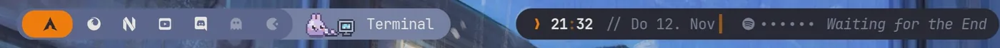

<div align="center">

# slate

**A calm, playful Hyprland desktop for Arch Linux.**<br>
Slate-blue glass, one orange accent, and small animations with a purpose.

[](https://archlinux.org)
[](https://hyprland.org)
[](https://www.chezmoi.io)
[](packages/)


[Features](#features) · [Install](#install) · [Shortcuts](#shortcuts) · [Make it yours](#make-it-yours) · [Docs](#docs)

</div>

---

## Why this one

- **One install script, everything else in the repo.** `bootstrap.sh` + `chezmoi`
  turn a plain Arch install into this desktop, asking only about your hardware.
- **One design system.** Every color, radius, gap and font lives in two TOML files;
  Hyprland, the bar, rofi, GTK/Qt, kitty, Neovim, notifications, the login screen
  and even GRUB are generated from them.
- **Official repos only.** No AUR helper, no curl-to-bash. Packages are plain lists.
- **Fast.** Bar menus are resident GTK windows that open instantly; the animated bar
  was profiled down to a few % CPU.
- **Safe to break.** btrfs snapshots before every pacman run, a rollback guide, and a
  `dots-check` command that shows anything the repo does not know about yet.

## Features

<table>
<tr>
<td width="50%" valign="top">

### A bar that feels alive

Music visualizer driven by `cava`, window titles that *type themselves*
(the system's signature typewriter effect), a blinking terminal-style clock,
playful state icons (the brightness icon is a day cycle, the CPU goes snail →
rabbit → rocket) and a pixel pet that reacts to your Claude Code session.

</td>
<td width="50%" valign="top">

### Spotlight-style launcher

`SUPER+Space`: apps as an icon grid. No match? Enter searches the web instead.
Same search pill and frame language as every other overlay.

</td>
</tr>
<tr>
<td></td>
<td></td>
</tr>
<tr>
<td valign="top">

### Wallpaper picker

`SUPER+W`: a preview grid of `~/Pictures/Wallpapers`. Enter sets the desktop,
Shift+Enter the login screen, or shuffle every 30 minutes. A new random pair
greets you at every login.

</td>
<td valign="top">

### Menus that open instantly

Sound (per-app volume), Bluetooth pairing, Wi-Fi, power profile and power menu:
small GTK4 popups that stay resident and appear under the mouse or centered.

</td>
</tr>
<tr>
<td></td>
<td></td>
</tr>
<tr>
<td valign="top">

### Dropdown terminal

`SUPER+Tab` slides a kitty terminal down over whatever you are doing.

</td>
<td valign="top">

### Every shortcut, one key away

`SUPER+H` builds this overview live from the bind descriptions in `binds.lua`,
so it can never go stale.

</td>
</tr>
<tr>
<td></td>
<td></td>
</tr>
</table>

### And under the hood

| | |
|---|---|
| **Gaming** | `game-watch` detects games by how they run (Steam, Proton/Wine, Modrinth, gamescope, ...) and turns on GameMode, the performance profile and a normal Alt key. Zero per-game setup. |
| **Power** | performance on AC, power-saver on battery, switched by udev. Battery icon fills with bolts while charging. |
| **Neovim** | built from scratch on `vim.pack` + `mini.nvim`, native LSP, `conform` formatting, same palette. |
| **Login & boot** | custom SDDM theme and an optional GRUB theme, both generated from the palette. |
| **Lock screen** | hyprlock with a typewriter greeting. |
| **Snapshots** | snapper + snap-pac: pre/post snapshots of `/` on every pacman transaction. |
| **Claude Code** | optional: `SUPER+C` toggles a long-running Claude session; the bar pet shows whether it is thinking, waiting or done. |

## Install

On an existing Arch install (any bootloader, any filesystem):

```sh
sudo pacman -S --needed git
git clone https://github.com/Fubge/dotfiles ~/.local/share/chezmoi
~/.local/share/chezmoi/bootstrap.sh     # add --dry-run to only look
reboot
```

It asks a few questions first:

```text
CPU vendor (microcode package)                     intel / amd      (detected)
Graphics (driver packages)                         intel / amd / nvidia / none
Keyboard layout (xkb, e.g. us, de, fr)             us
Locale for dates in the bar                        en_US.UTF-8
Internal display mode / scale                      preferred / auto
Install the gaming stack / personal apps           yes / yes
Manage the boot chain (GRUB, cmdline, console)?    no   <- leave this off unless
                                                           you follow docs/install.md
```

Then it enables multilib, installs every package list, applies the dotfiles,
installs the SDDM theme and enables the services. It is idempotent: run it again
any time. The full walkthrough, including a from-scratch LUKS + btrfs + UKI setup,
is in **[docs/install.md](docs/install.md)**.

> [!NOTE]
> Built and used daily on a ThinkPad X9-15p (Intel Arc, 2880x1800 OLED).
> AMD graphics should work out of the box; NVIDIA is wired up but untested.

## Shortcuts

`SUPER+H` shows all of them. The essentials:

| Keys | Action | Keys | Action |
|---|---|---|---|
| `SUPER+Space` | Launcher / web search | `SUPER+Q` | Terminal |
| `SUPER+W` | Wallpapers | `SUPER+Tab` | Dropdown terminal |
| `SUPER+V` | Clipboard history | `SUPER+B` | Browser |
| `SUPER+A` | Sound | `SUPER+SHIFT+B` | Bluetooth |
| `SUPER+N` | Wi-Fi | `SUPER+P` | Power profile |
| `SUPER+X` | Close (hides Spotify) | `SUPER+S` | Minimize / restore |
| `SUPER+F` | Float / tile | `SUPER+SHIFT+F` | Fullscreen |
| `SUPER+1..0` | Workspace | `SUPER+SHIFT+1..0` | Send window |
| `SUPER+L` | Lock | `SUPER+Escape` | Power menu |
| `Home` | Area screenshot to clipboard | `SUPER+G` | Mark window as game |

## Make it yours

| Want to change | Edit |
|---|---|
| Colors | [`.chezmoidata/palette.toml`](.chezmoidata/palette.toml) |
| Rounding, gaps, borders, fonts, overlay sizes | [`.chezmoidata/design.toml`](.chezmoidata/design.toml) |
| Keyboard, GPU, display, optional groups | `[data.machine]` in `~/.config/chezmoi/chezmoi.toml` |
| Apps, workspaces, autostart, window sizes | [`dot_config/hypr/vars.lua.tmpl`](dot_config/hypr/vars.lua.tmpl) |
| Shortcuts | [`dot_config/hypr/binds.lua`](dot_config/hypr/binds.lua) |
| Packages | [`packages/*.txt`](packages/) |

Then `chezmoi apply`. Every themed file is a template, so one palette change
re-colors the whole system, down to the boot menu.

## Layout

```text
.chezmoidata/        palette + design tokens shared by every template
.chezmoi.toml.tmpl   the install questions (machine settings)
dot_config/          ~/.config: hypr, waybar, rofi, kitty, nvim, dunst, gtk, qt ...
dot_local/bin/       ~/.local/bin: the bar modules, popups and helper scripts
dot_local/lib/       shared Python: typewriter effect, resident popups, bar pet
packages/            package lists (+ machine/ for CPU and GPU drivers)
system/              root files for every machine (SDDM theme, power switching)
system-boot/         root files for the full layout only (GRUB, kernel cmdline)
run_*                chezmoi scripts: packages, services, themes, reloads
bootstrap.sh         one-time setup of a new machine
```

## Docs

- **[Install](docs/install.md)** — existing Arch, or the full encrypted layout from scratch
- **[Cheatsheet](docs/cheatsheet.md)** — daily workflow, every feature explained
- **[System changes](docs/system-changes.md)** — everything outside `$HOME`, rollback guide

## Credits

[Hyprland](https://hyprland.org), [chezmoi](https://www.chezmoi.io),
[mini.nvim](https://github.com/echasnovski/mini.nvim), [cava](https://github.com/karlstav/cava),
[Nerd Fonts](https://www.nerdfonts.com) and [Papirus](https://github.com/PapirusDevelopmentTeam/papirus-icon-theme).
Wallpapers in the screenshots are not part of this repo.

Licensed under the [MIT License](LICENSE).
